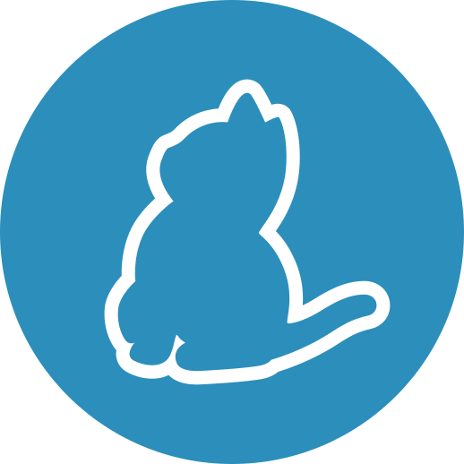

<!--  -->

<!--  -->

- 👋 Hi, I’m Basob Paul 
- 🏫  Graduate from Rajshahi University of Engineering and Technology. 
-   
- 📫 Email: **paulbrinto@gmail.com**

  
 

## 🤹🏻‍♂️ My Skill Set:

 

  

<!---
brinto59/brinto59 is a ✨ special ✨ repository because its `README.md` (this file) appears on your GitHub profile.
You can click the Preview link to take a look at your changes.
<<<<<<< HEAD
--->
